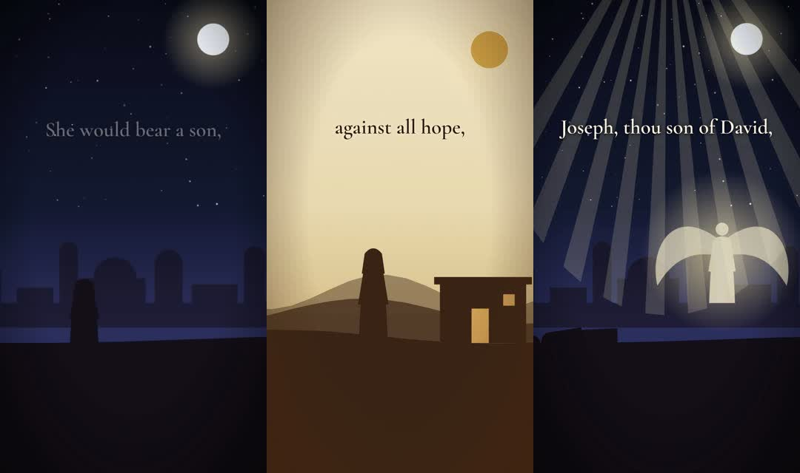
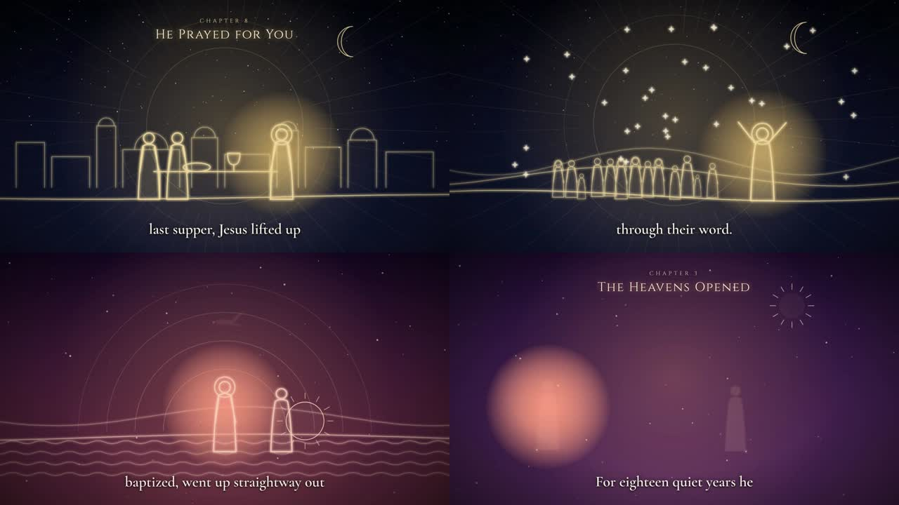

# How to Read This Book

This book explains one project completely: the machine in the `life-of-jesus-video` repository that writes, voices,
animates and renders Bible videos for a YouTube channel, on GitHub's computers, from one terminal command.

It starts from zero. You do not need to know anything about programming.

| If you are… | Read |
|---|---|
| new to computers and code | Part One from Chapter 0, in order, doing every *Try it* box; then Part Five |
| here to run the channel | Chapter 1, then Part Three (the operator's manual) |
| here to understand how it works | Part Two, then Part Four |
| here to build your own machine | Part One, then Part Five: a workshop that builds a working mini version from an empty folder |

- **Part One** explains every idea and tool from scratch: the terminal, Git and GitHub, Python, JSON, web pages,
  SVG drawing, animation, the renderer, the voice, FFmpeg, and GitHub's free cloud computers.
- **Part Two** walks through this project's machine, file by file.
- **Part Three** is the operator's manual: how to run the channel every week, add stories, and fix problems.
- **Part Four** goes deep: timing maths, determinism, audio, design decisions and the mistakes made while building.
- **Part Five** is hands-on: eleven lessons that build your own video machine, with every line of code, tested.
- **The appendices** are reference tables. Some are generated straight from the code, so they are always exactly
  right for this version.

Every code sample comes from the repository. When the book says *open `longform/lineart.py`*, open it, and read the
real thing next to the explanation. That is the fastest way to learn.

> **One idea to hold onto.** Everything in this project follows a single chain: *words you write → a web page that
> animates itself → a browser photographs every frame → a video file*. Every tool in this book exists to do one link
> of that chain, automatically.

<div class="page-break"></div>

# Part One — Foundations

## 0. Absolute Zero

If you have never written code, read this chapter slowly. Everything later builds on five ideas.

### 0.1 A program is a recipe

A **program** is a list of instructions for a computer, written so exactly that there is no room for guessing. A
cooking recipe says "add a pinch of salt"; a program must say "add 1.3 grams of salt". Computers are fast and
obedient, but they never guess what you meant.

The instructions are written in a **programming language**, a strict, simple kind of English. This project uses
three languages, each for what it is best at:

| Language | Used for | Looks like |
|---|---|---|
| **Python** | the logic: reading stories, timing, writing pages, running FFmpeg | `total = round(start + duration, 3)` |
| **HTML/CSS/SVG** | describing what a frame looks like | `<circle cx="960" cy="300" r="60"/>` |
| **JavaScript** | describing how it moves over time | `tl.to("#sun", { y: 200, duration: 4 })` |

Plus two **data formats**, which hold information but no instructions: **JSON** for the stories, and **YAML** for
the cloud workflows.

### 0.2 Code is just text

A program is a plain text file. You can open `generate.py` in any text editor and read it. Nothing is hidden. A
video, a page, a workflow: in this project they all start as text that you can read, change and save. The editor
you are using (VS Code) colours the text to make it easier to read, but the file itself is only letters.

### 0.3 Running code

To **run** a program means to hand the text to an **interpreter** that carries out the instructions:

```bash
python3 generate.py --status
```

Here `python3` is the interpreter, `generate.py` is the program, and `--status` is an **option** (an extra
instruction) for the program.

### 0.4 Errors are normal and useful

When something is wrong, programs stop and print an **error**. Beginners fear errors; experienced people read them
first, because they say exactly what went wrong and where:

```
AssertionError: the-parables-of-jesus: ~9:04, aim for 10:20-11:40
```

That line says: in the video `the-parables-of-jesus`, the estimated length is 9 minutes 4 seconds, which is too
short. Errors in this project were written to be read by people.

### 0.5 Automation is the whole point

Doing something by hand once is fine. Doing it a hundred times by hand is slow, boring and error-prone. **Automation**
means describing the steps once, as a program, and letting the computer repeat them perfectly. This whole book is
about one piece of automation: *turn a written Bible story into a finished video without touching a video editor.*

<div class="try" markdown="1">
**Try it.** Open the file `longform/videos/03-the-parables-of-jesus.json` in your editor. Find the line that says
`"title": "The Sower"`. Read the beats below it. You are reading the exact text the machine speaks and animates.
</div>

## 1. The Big Picture

### 1.1 What the machine makes

The repository produces three kinds of video:

| Product | Shape | Length | Look | Where it lives |
|---|---|---|---|---|
| **Story Shorts** | vertical 9:16, 1080×1920 | 29–44 seconds | paper-cut silhouette, or illuminated parchment | `shorts/` |
| **Long videos** | horizontal 16:9, 1920×1080 | 10–12 minutes | divine glowing line art, one colour template per video | `longform/` |
| **The timeline** | horizontal 16:9 | about 2 minutes | gold line icons on a timeline | `build.py`, `script.json` |

Every one of them is narrated by the same synthetic voice (Kokoro, voice `af_heart`), captioned in the same
typeface (Cormorant Garamond), scored with the same generated piano-and-pad music, and quoted from the King James
Version of the Bible, which is in the public domain.





### 1.2 The pipeline in one picture

```
 you                     GitHub (free computers)                                   you
 ───                     ───────────────────────                                   ───
 ./generate.py  ──push──▶ shorts.yml / long.yml
                           │
                           ├─ 1. read the story (JSON)
                           ├─ 2. Kokoro speaks every line  ──▶ voice.wav
                           ├─ 3. Python writes a web page   ──▶ index.html (SVG + GSAP timeline)
                           ├─ 4. HyperFrames opens it in Chrome, photographs every frame ──▶ MP4
                           ├─ 5. FFmpeg mixes music, sets loudness, joins chapters
                           └─ 6. publish to a GitHub Release ─────────────────────────────▶ videos/<date>/
```

You type one command. Your computer only sends a small text change to GitHub and later downloads the finished
files. All the heavy work, speech synthesis and frame-by-frame rendering, happens on GitHub's machines.

### 1.3 Why build videos this way?

A normal video editor works by hand: you drag clips onto a timeline. That is fine for one video. It is slow and
inconsistent for a hundred. This project treats a video as **data plus a program**:

- **The data** is a story written as text: what is said, what the sky looks like, who stands where, what they do.
- **The program** turns that data into a picture that moves, timed exactly to the voice.

The benefits are the reasons the project exists:

1. **Consistency.** Every video has the same fonts, colours, pacing and loudness, because the same code made them.
2. **Scale.** Writing the 90th story costs the same as writing the 1st. The machine does the rest.
3. **Correction is cheap.** Fix one word in the JSON and re-render. No re-editing.
4. **Free.** Every tool is open source, and GitHub gives public repositories unlimited free build minutes.
5. **Reproducible.** The same input always makes the same video, frame for frame.

The cost is that you must describe scenes in text rather than draw them. Part Three shows that this is easier than
it sounds.

## 2. The Terminal, Files and Folders

### 2.1 What a terminal is

A terminal is a window where you type commands instead of clicking. Each command is a small program. You type its
name, maybe some options, and press Enter. The project is designed to be run *only* from the terminal, with one
command, so it is worth being comfortable here.

On Linux you open it with **Ctrl+Alt+T**. You will see a *prompt*, something like:

```
sisyphus@machine:~$
```

The `~` means you are in your *home folder*. Everything you type runs "in" a current folder.

### 2.2 The six commands you need

| Command | Meaning | Example |
|---|---|---|
| `pwd` | print where I am | `pwd` |
| `ls` | list files here | `ls longform/videos` |
| `cd` | change folder | `cd "/home/sisyphus/Music/live/TapOBHumi calude generator/life-of-jesus-video"` |
| `cat` | show a text file | `cat generated.txt` |
| `./generate.py` | run the channel | `./generate.py --status` |
| `git status` | what changed in the repository | `git status` |

**Quotes matter.** The project folder's path contains spaces (`TapOBHumi calude generator`). The terminal splits
words on spaces, so a path with spaces must be wrapped in quotes, or the command will look in the wrong place.

**`./` matters.** `./generate.py` means "the file `generate.py` in *this* folder". Without `./`, the terminal looks
for a program called `generate.py` somewhere on the system and will not find it. The file is *executable* (it was
marked with `chmod +x`) and its first line, `#!/usr/bin/env python3`, tells Linux to run it with Python.

### 2.3 Paths

A path is an address for a file. An *absolute* path starts at the root `/`
(`/home/sisyphus/.../generate.py`). A *relative* path starts from the current folder (`longform/videos/01-the-prayers-of-jesus.json`).
The project's code always computes paths relative to its own files, so it works no matter where the repository
lives on disk:

```python
HERE = os.path.dirname(os.path.abspath(__file__))   # the folder this .py file is in
ROOT = os.path.dirname(HERE)                         # one level up: the repository
```

<div class="try" markdown="1">
**Try it.** Open a terminal and type, one line at a time:

```bash
cd "/home/sisyphus/Music/live/TapOBHumi calude generator/life-of-jesus-video"
pwd
ls
ls longform/videos
./generate.py --status
```

You moved into the project, printed where you are, listed its files, listed the long videos, and asked the machine
what it has made so far. Nothing was changed.
</div>

## 3. Git and GitHub

### 3.1 Git: a time machine for folders

**Git** records snapshots of a folder. Each snapshot is a **commit**: a set of changes plus a message saying why.
The folder with its history is a **repository** (repo). Git lets you see what changed, undo mistakes, and copy the
whole history to another computer.

The everyday loop:

```bash
git status                      # what has changed?
git add longform/videos/11-*.json
git commit -m "Long video 11: The Seven Last Words"
git push                        # send my commits to GitHub
git pull                        # get commits that are on GitHub but not here
```

### 3.2 GitHub: the shared copy, and free computers

**GitHub** hosts a copy of the repository online (`github.com/Aayush-13-cpu/life-of-jesus-video`). It gives this
project three things:

1. **A backup and a shared copy** you can clone on any computer.
2. **GitHub Actions**: computers that run your scripts automatically when something happens, such as a push.
   Chapter 11 covers them. For public repositories they are free with no minute limit.
3. **Releases**: download pages that hold the finished videos.

### 3.3 Tokens and permissions (and why pushes fail)

When your computer talks to GitHub it proves who you are with a **personal access token**, a long secret string,
stored by the GitHub CLI `gh` in your system keyring. A *fine-grained* token has a list of permissions per
repository. This project needs:

| Permission | Level | Why |
|---|---|---|
| **Contents** | Read and write | push commits (the render queue, the record of what was made) |
| **Workflows** | Read and write | push changes to files in `.github/workflows/` |
| **Actions** | Read | let `generate.py` find and watch the render runs |

Two real errors from building this project show what happens without them:

```
refusing to allow a Personal Access Token to create or update workflow
`.github/workflows/long.yml` without `workflow` scope
```
The token could push code but not workflow files. Fix: give it **Workflows: Read and write**.

```
could not create workflow dispatch event: HTTP 403: Resource not accessible by personal access token
```
The token could not *start* a workflow by hand. Instead of asking for one more permission, the machine was
redesigned so that a normal push starts the render (Chapter 15 explains how). That is why only the three
permissions above are needed.

> **Never paste a token into a file in the repository.** It is a password. The project never stores one; `gh`
> keeps it in your system keyring.

## 4. Python, Just Enough

The machine's logic is written in **Python 3**. You do not need to be a programmer to run it, but to change it you
need a few ideas.

### 4.1 Values, lists and dictionaries

```python
title = "The Prayers of Jesus"          # a string (text)
speed = 0.94                            # a number
beats = ["first line", "second line"]   # a list: an ordered sequence
beat = {"say": "Peace, be still.",      # a dictionary: names → values
        "sky": "storm", "land": "sea"}
beat["sky"]                             # → "storm"
```

Almost all of the project's data is lists of dictionaries: a video is a dictionary with a list of chapters; a
chapter has a list of beats; a beat has a list of cast members; a cast member has a list of acts.

### 4.2 Functions

A function is a named recipe. This one, from `longform/build_long.py`, turns the measured length of each spoken
line into the start time and duration of each scene:

```python
def timings(voice_secs):
    slots, t = [], 0.0
    for v in voice_secs:
        d = round(LEAD + v + TAIL, 3)
        slots.append((t, d))
        t = round(t + d, 3)  # rounded each step so a beat starts exactly where the last one ends
    return slots
```

Read it as: *for each line of narration lasting `v` seconds, the scene lasts a little silence (`LEAD`), the line
itself, and a breath afterwards (`TAIL`). Each scene starts where the previous one ended.*

### 4.3 f-strings: Python writing text

Most of the project is Python writing other languages: SVG, HTML, JavaScript, FFmpeg commands. The tool for that is
the **f-string**, a string with `{expressions}` inside:

```python
x, y, s = 960, 850, 1.5
f'<g transform="translate({x},{y}) scale({s})">'   # → <g transform="translate(960,850) scale(1.5)">
```

When you see `{{` and `}}` in the page templates, that is how you write a literal brace inside a template that
Python fills with `.format()`.

### 4.4 Modules and virtual environments

`import json` loads Python's built-in JSON module. `from kokoro_onnx import Kokoro` loads an installed package.
Packages are installed with `pip`. To keep this project's packages separate from the rest of the system, the local
copy has a **virtual environment** in `.venv/` (`python3 -m venv .venv`). Run the tests with it:

```bash
.venv/bin/python longform/test_long.py
```

`generate.py` deliberately uses **only the standard library**, so it runs with plain `python3` on any machine, with
nothing installed.

## 5. JSON: The Language of the Stories

**JSON** (JavaScript Object Notation) is plain text for lists and dictionaries. Every story in the project is JSON.
Here is one beat of a long video:

```json
{"say": "And he arose, and rebuked the wind, and said unto the sea: Peace, be still.",
 "sky": "night", "land": "sea", "fx": ["rays"],
 "cast": [{"k": "boat", "x": 960, "y": 800, "s": 1.3, "acts": [{"do": "rock", "amp": 1, "period": 4.0}]},
          {"k": "jesus", "in": 0, "x": 80, "y": -40, "s": 0.8, "flip": true, "acts": [{"do": "raise", "at": 0.4}]}]}
```

Rules that trip people up:

- Strings use **double quotes** `"..."`, never single quotes.
- Items are separated by commas, and the **last item has no comma** after it.
- `true`, `false` and `null` are lowercase.
- No comments are allowed. (The files use a `"_style"` key or the README for notes instead.)

If you break the format, the self-checks fail immediately with the line number, before anything is rendered.
That is the point of the checks.

## 6. The Web Page: HTML, CSS, SVG

### 6.1 Why a web page?

A web browser is the most capable free drawing engine in the world. It draws text in any font, shapes, gradients,
glows and transparency, and it animates them smoothly. If a browser can be told to *pause* the animation, jump to
an exact moment and take a picture, a web page becomes a video. That is exactly what HyperFrames does (Chapter 8).

### 6.2 HTML and CSS

**HTML** describes what is on the page (`<div>`, `<section>`, `<audio>`), and **CSS** describes how it looks
(position, colour, font). A caption in a long video is a `<div>` with a `<span>` inside, styled like this:

```css
.cap span { margin-bottom: 64px; max-width: 1500px; text-align: center; color: #fff8ec;
            font: 600 64px/1.1 "Cormorant", serif;
            text-shadow: 0 0 18px rgba(0,0,0,0.85), 0 4px 6px rgba(0,0,0,0.7); }
```

The double shadow is what keeps white text readable over any background.

### 6.3 SVG: pictures made of text

**SVG** (Scalable Vector Graphics) describes pictures as shapes. Three ideas carry you most of the way:

**Coordinates.** `viewBox="0 0 1920 1080"` makes a canvas 1920 wide and 1080 tall. `x` grows to the right, and
`y` grows **downward**, so `y = 0` is the top. In the long videos the horizon is at `y = 760` and people stand on
the ground line at `y = 850`.

**Paths.** A `<path d="...">` draws any outline. `M` moves the pen, `L` draws a line, `C` and `Q` draw curves, `A`
draws an arc, `Z` closes the shape. Every robed figure is one path:

```
M-30 0 C-28 -60 -24 -118 -17 -150 Q0 -160 17 -150 C24 -118 28 -60 30 0 Z
```

It starts at the left foot (−30, 0), curves up to the shoulders at y = −150, over the top, and back down to the
right foot. The figure is drawn around the point **where it touches the ground, (0, 0)**, so it can be placed
anywhere by moving that one point.

**Groups and transforms.** `<g transform="translate(960,850) scale(1.5)">…</g>` draws everything inside, shifted
to (960, 850) and one and a half times bigger. Draw a figure once around (0, 0), then place it anywhere, any size,
facing left (`scale(-1.5, 1.5)`) or right.

### 6.4 The two SVG tricks behind the line-art look

**Tracing lines in.** Give a path `pathLength="1"`. Now the browser treats its length as 1, whatever its real
length. Set `stroke-dasharray: 1` (a dash as long as the whole path) and `stroke-dashoffset: 1` (shift the dash
completely off the path): the line is invisible. Animate the offset from 1 to 0 and the line *draws itself*, like
a pen. Every line in a long video does this when its scene begins.

**The divine glow.** An SVG filter blurs a copy of the drawing and lays the sharp lines on top:

```xml
<filter id="b0-glow"><feGaussianBlur stdDeviation="5" result="b"/>
  <feMerge><feMergeNode in="b"/><feMergeNode in="b"/><feMergeNode in="SourceGraphic"/></feMerge></filter>
```

Two blurred copies plus the original give lines that seem to give off light.

<div class="try" markdown="1">
**Try it.** Make a file called `sun.html` anywhere, paste this, save, and open it in a web browser by double-clicking:

```html
<svg viewBox="0 0 400 300" width="400" style="background:#0a0c22">
  <path d="M0 230 Q200 180 400 230" fill="none" stroke="#f0d79c" stroke-width="3"/>
  <circle cx="200" cy="120" r="40" fill="none" stroke="#f0d79c" stroke-width="3"/>
</svg>
```

You drew a hill and a sun with two lines of SVG. Change `cy="120"` to `cy="60"` and reload: the sun rises.
</div>

## 7. Animation with GSAP

**GSAP** (GreenSock Animation Platform) is a JavaScript library for animation. You give it an element, what to
change, how long to take, and when:

```js
const tl = gsap.timeline({ paused: true });
tl.to("#b2-c3", { x: 1100, duration: 4, ease: "sine.inOut" }, 12.4);
```

Read it as: *on the timeline, at 12.4 seconds, move cast member 3 of beat 2 to x = 1100 over 4 seconds, gently.*

- A **timeline** is a list of animations ("tweens") placed at exact times.
- `to` animates from the current value; `fromTo` sets both ends (safer when the playhead can jump around);
  `set` changes a value instantly.
- **Ease** is the feel: `"none"` is mechanical, `"power2.out"` starts fast and settles, `"sine.inOut"` is gentle
  at both ends.
- `repeat` and `yoyo` make a back-and-forth (a rocking boat, a flickering flame). In this project every repeat is
  *finite*, for the reason in the next chapter.
- `paused: true` is essential: the timeline must not play by itself, because HyperFrames moves it frame by frame.

<div class="try" markdown="1">
**Try it.** Add these lines to the bottom of your `sun.html`, after the `</svg>`, and reload the page. The sun rises
on its own and the hill draws itself in, the same two tricks the long videos use:

```html
<script src="https://cdn.jsdelivr.net/npm/gsap@3.14.2/dist/gsap.min.js"></script>
<script>
  const hill = document.querySelector("path"), sun = document.querySelector("circle");
  hill.setAttribute("pathLength", "1");
  gsap.fromTo(hill, { strokeDasharray: 1, strokeDashoffset: 1 }, { strokeDashoffset: 0, duration: 2 });
  gsap.fromTo(sun, { attr: { cy: 230 } }, { attr: { cy: 120 }, duration: 4, ease: "power2.out" });
</script>
```
</div>

## 8. HyperFrames: Turning a Page into a Video

**HyperFrames** (open source, Apache 2.0, by HeyGen) opens your page in a hidden Chrome browser, moves the timeline
to frame 0, photographs the page, moves to frame 1, photographs again, and so on, at 30 frames per second. Then it
joins the pictures and the audio into an MP4 with FFmpeg.

### 8.1 The contract a page must follow

```html
<div id="root" data-composition-id="long-chapter" data-start="0" data-duration="61.9"
     data-width="1920" data-height="1080">
  <section id="beat-0" class="clip" data-start="0" data-duration="13.2"> … scene 1 … </section>
  <section id="beat-1" class="clip" data-start="13.2" data-duration="11.8"> … scene 2 … </section>
  <audio id="voice" src="assets/voice.wav" data-start="0" data-duration="61.9"></audio>
</div>
<script> window.__timelines = window.__timelines || {};
         window.__timelines["long-chapter"] = tl; </script>
```

- `data-start` and `data-duration` say when each clip is visible or audible. HyperFrames shows and hides clips.
- The GSAP timeline is registered under the composition's id, after every tween is added.
- `npx hyperframes lint` checks the rules; `npx hyperframes render --quality high --output x.mp4` makes the video.

### 8.2 Determinism: the most important rule

HyperFrames may photograph frames in any order, and on several browser tabs at once. So **frame 412 must look the
same every time it is drawn**. That rules out:

- the clock (`Date.now()`), because time passes differently for each frame;
- unseeded randomness (`Math.random()`), because stars would jump between frames;
- infinite repeats, because the end state of "forever" is undefined;
- anything loading in the middle.

The project's answer to randomness is a tiny seeded generator, `rng(seed)`, a *linear congruential generator*
that produces the same "random" sequence every time for the same seed:

```python
def rng(seed):
    s = seed & 0x7FFFFFFF
    def r():
        nonlocal s
        s = (s * 1103515245 + 12345) & 0x7FFFFFFF
        return s / 0x7FFFFFFF
    return r
```

Stars, raindrops, embers and grass tufts are all placed with it, so they are identical on every frame and every
render.

## 9. A Voice from Text: Kokoro

**Kokoro** is a small open-source neural text-to-speech model (Apache 2.0, so monetised videos are fine). This
project uses the `kokoro-onnx` package, which runs the model with ONNX Runtime on an ordinary CPU, no graphics card
needed. Two files are downloaded once and cached: `kokoro-v1.0.onnx` (the model, about 325 MB) and
`voices-v1.0.bin` (the voice styles, about 28 MB).

```python
from kokoro_onnx import Kokoro
k = Kokoro("models/kokoro-v1.0.onnx", "models/voices-v1.0.bin")
audio, sample_rate = k.create("Peace, be still.", voice="af_heart", speed=0.94, lang="en-us")
```

`af_heart` is Kokoro's highest-rated English voice. `speed` below 1 slows it slightly for a calm, devotional pace.
The output is a list of numbers (audio samples) at 24,000 samples per second, so its length in seconds is
`len(audio) / 24000`.

**The voice decides the timing.** Nothing in this project is timed by hand. Each line is spoken first, measured,
and only then is its scene given a duration. That is why the animation always matches the narration.

**Measuring the speaking rate.** To check a video's length *before* spending a render, the code estimates speech
time as `words ÷ words-per-second`. The first estimate, 2.55 words per second, was a guess. Measured on six real
rendered chapters, `af_heart` at speed 0.94 speaks about **3.24 words per second**. Using the guess, videos planned
at 10:45 came out at about 8:50. The constant `WPS = 3.24` in `longform/build_long.py` is now the measured value.
Chapter 25 tells that story in full.

## 10. Sound and Video Surgery: FFmpeg

**FFmpeg** is the Swiss-army knife of audio and video. The project uses it for five jobs.

**1. Making music from maths.** `aevalsrc` turns a formula into sound. The music bed is four soft chords, C, G,
A minor and F, each swelling in and out over 16 seconds, plus a gentle plucked note every 2 seconds, then smoothed
with a low-pass filter and an echo (`music()` in `build.py`). No licensed track is needed, so there are no
copyright claims.

**2. Joining chapters.** The concat demuxer joins MP4 files without re-encoding when they share the same settings:

```bash
ffmpeg -f concat -safe 0 -i list.txt -c copy joined.mp4
```

**3. Mixing.** `amix` lays the music under the voice. `normalize=0` adds them as they are, keeping their balance.

**4. Loudness.** YouTube plays everything at about **−14 LUFS** (Loudness Units relative to Full Scale, a measure
of perceived loudness). A quieter video just sounds weak next to others. The `loudnorm` filter brings each video to
−14 LUFS with true peaks below −1.5 dB:

```
loudnorm=I=-14:TP=-1.5:LRA=11
```

**5. Thumbnails and stills.** `-ss 8 -frames:v 1` grabs one frame. `drawbox` and `drawtext` paint the title on a
dark band in Cinzel. `ffprobe` reads durations, which become the YouTube chapter timestamps.

## 11. Someone Else's Computer: GitHub Actions

**GitHub Actions** runs scripts on GitHub's computers when something happens in the repository. A **workflow** is a
YAML file in `.github/workflows/` that lists **jobs**, and each job lists **steps**.

### 11.1 Triggers

```yaml
on:
  push:
    branches: [main]
    paths: ["longform/render.txt"]   # only when this file changes
  workflow_dispatch:                 # or by hand, from the Actions tab
```

A **path filter** means the workflow runs only when certain files change. This is how `generate.py` starts renders:
it changes `shorts/render.txt` and `longform/render.txt` and pushes. Commits whose message contains `[skip ci]`
start nothing at all, which is how library edits avoid wasting renders.

### 11.2 Jobs, matrices and parallelism

A **matrix** runs one job many times with different inputs, in parallel. The long-video workflow has one matrix
entry per chapter, so a 13-chapter video is rendered by 13 computers at once:

```yaml
render:
  strategy:
    fail-fast: false
    max-parallel: 20
    matrix:
      ch: ${{ fromJson(needs.plan.outputs.chapters) }}
```

`needs:` orders jobs: `plan` → `render` (many) → `finish` (one per video).

### 11.3 Passing files between jobs

Each job runs on a fresh computer, so files are passed as **artifacts**: `upload-artifact` in the render job,
`download-artifact` in the finish job (`pattern: ch-<video>--*`, `merge-multiple: true`). Artifacts are kept for 3
days. The finished products go to a **Release** (`gh release upload long-7 …`), which is permanent.

### 11.4 Caching

The voice model is 350 MB. `actions/cache` keeps the `models/` folder between runs under the key `kokoro-v1.0`,
so it is downloaded once, not on every job.

### 11.5 Reading failures

Every failing step re-prints its error as an `::error::` annotation, which shows at the top of the run page,
readable without logging in. When a render fails, open the run link that `generate.py` prints and read the red
annotation first.

<div class="page-break"></div>

# Part Two — How the Machine Works

## 12. A Map of the Repository

```
generate.py                  ONE COMMAND: picks the next videos, renders them on GitHub, downloads them
generated.txt                the record of what has been made (one line per video)
SKILLS.md                    Claude Code skills that help run the channel
README.md                    the short field guide

shorts/                      ── the vertical Shorts ──
  stories.json               20 stories, silhouette style (the original set)
  stories_parchment.json     20 stories, parchment style (the original set)
  stories_library.json       50 new stories, both styles: the queue generate.py works through first
  kit.py                     the drawing kit: skies, grounds, figures, props, effects, two palettes
  build_short.py             narrates one story and writes its page (+ the animation interpreter)
  test_shorts.py             checks every story before rendering
  render.txt                 which story ids the next Shorts run renders
  fetch.py                   downloads a Shorts release (optional; generate.py does this for you)

longform/                    ── the 16:9 long videos ──
  videos/NN-<id>.json        one file per video; the number is the upload order (01 … 10)
  lineart.py                 the glowing line-art kit: 20 templates, skies, lands, figures, props, effects
  build_long.py              narrates one chapter and writes its page; joins chapters into the video
  test_long.py               checks every video: 10-12 minutes, own template, valid staging
  render.txt                 which video ids the next long run renders

build.py, script.json        the 2-minute timeline video (and the shared music generator)
test_build.py                its check
fonts/                       Cinzel and Cormorant Garamond (SIL Open Font License)
docs/book/                   this book: book.md, its images, and build_book.py that makes the PDF

.github/workflows/
  shorts.yml                 renders Shorts in parallel, publishes them to a release shorts-N
  long.yml                   renders long-video chapters in parallel, joins them, publishes to long-N
  render.yml                 renders the timeline video
```

Two folders are deliberately **separate**: the Shorts code in `shorts/` and the long-video code in `longform/`.
The long videos import nothing from `shorts/`, so changing one can never break the other. The only shared piece is
the music generator in `build.py`.

## 13. The Shorts, Step by Step

### 13.1 A story

A Short is a list of **beats**. Each beat is one sentence of narration plus the scene that acts it out. This is the
whole of one beat from `shorts/stories_library.json`:

```json
{"say": "Hail, thou that art highly favoured, the Lord is with thee: blessed art thou among women.",
 "sky": "night", "ground": "city", "fx": ["rays"],
 "cast": [{"k": "angel", "x": 760, "y": 1300, "s": 1.4, "flip": true,
           "acts": [{"do": "appear", "at": 0.3}, {"do": "bless", "at": 1.4}]},
          {"k": "woman", "x": 380, "s": 1.55, "acts": [{"do": "kneel", "at": 1.0}]}]}
```

Read it as a stage direction: *at night, in the city, rays of light. An angel at x 760, slightly raised, facing
left, fades in after 0.3 seconds and blesses at 1.4. A woman at x 380 kneels after one second.* The story also has
an `id` (its name in files), a `title` (shown for the first three seconds), a `ref` (the verse shown at the end),
a `genre`, and an optional `"style": "parchment"`.

### 13.2 What `build_short.py` does

Running `python shorts/build_short.py the-annunciation` performs six steps:

1. **Narrate.** `narrate()` speaks every beat with Kokoro (voice `af_heart`, speed 0.94), measures each clip, and
   lays them on one track with 0.35 s of silence before each line and 0.6 s after it, plus 1.2 s of music at the end.
2. **Time.** `timings()` turns the measured lengths into exact start times, rounded at every step so scenes butt
   together with no gap and no overlap. A Short must stay under 59 seconds.
3. **Caption.** `chunks()` cuts each sentence into blocks of up to five words, preferring to break after
   punctuation; `captions()` spreads the blocks across the spoken time in proportion to their length. Most Shorts
   are watched with the sound off, so the captions carry the story.
4. **Compose.** `compose_beat()` asks the kit for the sky, the ground, each cast member and the effects, and
   collects their actions as plain instructions with absolute times.
5. **Write the page.** `render_html()` fills the HTML template: one `<section>` per beat, the captions, a title card
   for the first 3.2 s, the verse reference on the last beat, the voice and the music.
6. **Music.** `music(total)` from `build.py` generates the bed to the exact length.

Then the workflow lints the page, renders it, normalises loudness, and saves four preview stills.

### 13.3 The camera

A static drawing would feel dead. Each beat fades in over 0.35 s, out over 0.3 s, and **pushes in slowly** from
scale 1.24 to 1.31, centred low in the frame where the action is. It is a simple trick that makes every scene feel
filmed.

### 13.4 The silhouette kit (`shorts/kit.py`)

- **Everything stands on the ground line.** Near figures stand at `y = 1390` (`FEET`); the horizon is at 1300.
- **Two groups per figure.** The outer group moves across the screen (walk, run, climb); the inner group `-b` bends
  in place (kneel squashes it, lie rotates it, rock tilts it). Splitting "where it is" from "how it bends" keeps the
  two kinds of motion from fighting.
- **Arms are their own groups** (`-al`, `-ar`) hinged at the shoulder, so a figure can raise, reach or bless.
- **Nesting.** `"in": 0` draws a figure *inside* cast member 0, so people in a boat rock with the boat.
- **Faces are never drawn.** Jesus is a figure surrounded by soft light (`-glow`), never an invented face. The glow
  sits outside the bending group so that when he kneels or lies, he pivots at his feet, not around the glow.
- **Two palettes.** `kit.use("parchment")` swaps every colour: skies, ink, rain, rays.

### 13.5 The animation interpreter

Stories never contain JavaScript. They contain **verbs**: `walk`, `kneel`, `rock`, `tint`. The page holds a small
dictionary `F` that turns each verb into GSAP calls:

```js
walk:  a => { tl.to(a.t, { x: a.to, duration: a.d, ease: "sine.inOut" }, a.s); bob(a.t, a.s, a.d, 0.62, 7); },
kneel: a => tl.to(a.t + "-b", { scaleY: 0.68, duration: 0.7, ease: "power2.out" }, a.s),
```

`a.t` is the element, `a.s` the start time, `a.d` the duration. `walk` slides the outer group and bobs the inner
one. `kneel` squashes the inner group from the feet up. Appendix B lists every verb.

## 14. The Long Videos, Step by Step

### 14.1 What makes them different

| | Shorts | Long videos |
|---|---|---|
| Frame | 1080×1920 vertical | 1920×1080 horizontal |
| Length | under 59 s | 10–12 minutes |
| Look | filled silhouettes or parchment | glowing lines that draw themselves |
| Structure | one story, 4 beats | 10–15 chapters, about 55 beats |
| Rendering | one page | one page *per chapter*, in parallel, then joined |
| Music | inside each page | one unbroken bed laid under the joined video |
| Extras | four preview stills | YouTube description with chapter timestamps, and a thumbnail |
| Code | `shorts/` | `longform/` (independent) |

### 14.2 A video file

Each long video is one JSON file in `longform/videos/`. The file name's number sets the upload order.

```json
{
  "id": "the-parables-of-jesus", "template": "olivet",
  "title": "The Parables of Jesus", "thumbnail": "The Parables of Jesus",
  "description": "Jesus taught the deepest truths with the simplest stories ...",
  "tags": ["#jesus", "#parables", "#prodigalson", "#goodsamaritan", "#bible", "#kjv", "#christian"],
  "chapters": [
    {"title": "The Sower", "ref": "Matthew 13:3",
     "beats": [
      {"say": "Behold, a sower went forth to sow. ...", "sky": "dawn", "land": "field",
       "cast": [{"k": "man", "x": 500, "acts": [{"do": "walk", "to": 1100, "at": 0.4, "dur": 7}]}]}
     ]}
  ]
}
```

Coordinates are the frame's own: x from 0 to 1920 (900–1100 is centre stage), people stand on `y = 850` unless
you give a `y`. Scale `s` defaults to 1.5 for figures.

### 14.3 The line-art kit (`longform/lineart.py`)

**Templates.** One per video, the rule enforced by the tests. A template is a line colour, a glow colour, five sky
gradients and a **motif**, the moving light behind every scene. Eighteen of the twenty are made from four colours by
`_template()`, which derives the five skies by blending the night sky toward warm (dawn), red (dusk), blue (day) or
grey (storm) with `_mix()`. Appendix C shows them all as colour swatches.

**Motifs.**

- `sunburst`: 48 thin rays around the centre, turning slowly (`spin`, 6 degrees per scene).
- `motes`: 80 embers of light rising through the frame (`rise`), and sunrise rings on the horizon.
- `constellation`: bright stars joined by lines that trace themselves in like the scene (`twinkle`).
- `halo`: concentric rings of light around the centre, breathing slowly (`pulse`).

**Lands.** `hills field desert city sea garden mountain river`, each drawn as lines: ridges, grass ticks, a skyline,
waves that drift, olive trees, mountain peaks, a flowing river.

**Figures.** The same robed outline as the Shorts, but as lines with a faint fill. Jesus, Mary and angels carry a
halo ring; Jesus and angels carry a soft radial glow. People: `jesus man woman child elder shepherd angel mary`.

**Props.** Twenty-five line drawings, listed in Appendix B: `cross boat lamp tree stone tomb star dove bread fish
cup scroll sheep well house manger table net thorns basket fire mat birds stones`.

### 14.4 How a scene draws itself

Every line that should trace in is written with a class and a path length:

```python
D = 'class="d" pathLength="1"'      # traced in, with a faint fill
N = 'class="d n" pathLength="1"'    # traced in, never filled (open lines)
F = 'class="d f" pathLength="1"'    # traced in, then glowing solid (flames, the star)
```

CSS hides them all at the start (`stroke-dasharray: 1; stroke-dashoffset: 1`), and one tween per beat reveals them
in document order: land first, then figures and props, then effects:

```js
tl.fromTo("#" + b.id + "-in .d", { strokeDashoffset: 1 },
          { strokeDashoffset: 0, duration: 2.2, ease: "power2.inOut", stagger: { amount: 1.6 } }, b.s + 0.1);
```

Everything except the background sits inside one group with the glow filter, so every line glows.

### 14.5 The chapter page

`build_long.py chapter <video> <n>` makes one chapter: it narrates the beats (same voice and speed as the Shorts,
0.6 s before and 1.6 s after each line, 1.6 s held at the end), writes captions at the bottom of the frame, a
chapter card for the first 4.2 seconds (*Chapter 3* over the chapter title), the verse reference over the last
beat, and **no music**. A gentle camera push (scale 1.00 to 1.05) keeps each scene alive.

### 14.6 Joining a video: `finish`

When all chapters of a video are rendered, `build_long.py finish <video> <dir> <out>`:

1. measures each chapter with `ffprobe`, so it knows where each chapter starts;
2. joins them with the concat demuxer, without re-encoding;
3. generates **one** music bed for the whole length, so the music never restarts at a chapter;
4. mixes voice and music, normalises to −14 LUFS, and writes `<id>.mp4` with `+faststart` (playable while
   uploading);
5. writes `<id>.txt`: title, description, **chapter timestamps** (YouTube turns these into chapters, because the
   first is `0:00`, there are at least three, and each is longer than 10 seconds), the scripture list and hashtags;
6. makes `<id>.jpg`, a 1280×720 thumbnail: a frame from the first chapter with the thumbnail title in Cinzel on a
   dark band;
7. warns if the result is outside 10–12 minutes.

## 15. `generate.py`: One Command for the Channel

### 15.1 What it does

```bash
./generate.py
```

1. **Pick.** Reads the library in order (`longform/videos/` by file number; Shorts from `stories_library.json`,
   then the older sets) and skips anything listed in `generated.txt`. Default: the next 2 long videos and 5 Shorts.
2. **Queue.** Writes the picks into `longform/render.txt` and `shorts/render.txt`, with a `# queued <time>` line so
   the files always change.
3. **Start.** Commits and pushes. The two workflows watch those files (`long.yml` watches `longform/render.txt`;
   `shorts.yml` watches `shorts/`), so the push itself starts both renders. No extra permission is needed.
4. **Find the runs.** Asks GitHub for the runs started by that exact commit (`gh run list --commit <sha>`) and
   prints their links.
5. **Wait.** `gh run watch --exit-status` follows each run until it finishes.
6. **Download.** `gh release download long-N` and `shorts-N` into `videos/<today>/long/` and
   `videos/<today>/shorts/`.
7. **Record.** Appends the finished ids to `generated.txt` and pushes it, marked `[skip ci]`.

### 15.2 Why it is safe to interrupt

Nothing is marked as made until it is downloaded. If you close the terminal, the render keeps going on GitHub. If a
render fails, `generated.txt` is untouched, and the next `./generate.py` picks the same items again.

### 15.3 The options

| Command | Does |
|---|---|
| `./generate.py` | the next 2 long videos and 5 Shorts |
| `./generate.py --long 1 --shorts 3` | choose how many |
| `./generate.py --long 0 --shorts 5` | Shorts only |
| `./generate.py --status` | how many are made and how many are left, and what comes next |
| `./generate.py --dry-run` | show the next picks and change nothing |
| `./generate.py --redo ID ...` | forget that these were made, so the next run makes them again |

### 15.4 What you get

```
videos/2026-11-14/
  long/   the-prayers-of-jesus.mp4   the video, ready to upload
          the-prayers-of-jesus.txt   title, description with chapters, scripture, hashtags
          the-prayers-of-jesus.jpg   1280×720 thumbnail
          the-prayers-of-jesus-t5.jpg … -t480.jpg   preview stills
  shorts/ the-annunciation.mp4       each Short
          the-annunciation-t1.jpg …  preview stills
```

## 16. The Workflows in Detail

### 16.1 `shorts.yml`

- **Trigger:** a push to `main` that changes anything in `shorts/`, or by hand.
- **plan:** reads `shorts/render.txt` into a list, creates the release `shorts-N`.
- **render** (one job per story, up to 20 at once, 30-minute limit): install Node 22, Python 3.11 and FFmpeg;
  restore the cached voice model; run `test_shorts.py`; build the page; lint; render; normalise loudness; save four
  stills; upload to the release.

### 16.2 `long.yml`

- **Trigger:** a push to `main` that changes `longform/render.txt`, or by hand. Editing videos starts nothing.
- **plan:** runs `test_long.py`, prints the matrix (`build_long.py plan`), creates the release `long-N`.
- **render** (one job per chapter, up to 20 at once, 90-minute limit): narrate and compose the chapter, lint,
  render, upload the chapter as an artifact `ch-<video>--<nn>`.
- **finish** (one job per video, after every chapter succeeds): download that video's chapters, run `finish`,
  save five stills, upload the MP4, description and thumbnails to the release.

If any chapter fails, its video's finish job does not run, so you never get a video with a missing chapter.

### 16.3 `render.yml`

Renders the original 2-minute timeline video when `script.json` or `build.py` changes, and attaches it to the run
as an artifact.

<div class="page-break"></div>

# Part Three — Running the Channel

## 17. The Weekly Routine

The library holds **10 long videos and 50 new Shorts**. At one long video every three days, that is a month of
long-form; the Shorts last longer. A typical rhythm:

1. **Generate a batch** (about once a week):
   ```bash
   cd "/home/sisyphus/Music/live/TapOBHumi calude generator/life-of-jesus-video"
   ./generate.py
   ```
   Leave it running for about an hour, or close the window and run it again later to collect the files.
2. **Watch every video with sound before publishing.** The machine is consistent, but only a human can catch a
   pronunciation that sounds wrong or a scene that reads badly.
3. **Upload the long video** to YouTube:
   - **Title:** the first line of `<id>.txt`. Optionally refine it with `/yt-package` (see `SKILLS.md`).
   - **Description:** paste the whole `<id>.txt`. The `Chapters` block becomes YouTube chapters automatically.
   - **Thumbnail:** `<id>.jpg`, or one of the `-t*.jpg` stills.
4. **Upload the Shorts** one or two a day. A vertical video under 60 seconds is automatically a Short.
5. **Check `./generate.py --status`** to see how much of the library is left.

## 18. Writing a New Short

1. **Pick the moment and the line.** One story, four beats, about 90–120 words in total. Open with a hook for
   adults (a situation, a stake), quote the King James Version exactly where you quote Scripture, and end with one
   line that speaks to grown-up life.
2. **Add it** to the end of `shorts/stories_library.json`, with a unique `id`, a `title`, a `ref`, a `genre`, and
   `"style": "parchment"` if you want that look.
3. **Stage each beat.** Choose a `sky` (`dawn day dusk night storm`) and a `ground`
   (`hills field desert city sea garden`), then the cast. Story coordinates are 1080 wide by 1920 tall; people stand
   on `y = 1390` by default and look right around scale 1.5–1.6.
4. **Check:** `.venv/bin/python shorts/test_shorts.py`. It catches unknown props or verbs, bad `in` links, duplicate
   ids and stories that would run past the Shorts limit.
5. **Commit with `[skip ci]`** so the push does not trigger a render of whatever is in `render.txt`:
   ```bash
   git add shorts/stories_library.json
   git commit -m "Short: the widow's oil [skip ci]"
   git push
   ```
   The next `./generate.py` will pick it up when its turn comes.

## 19. Writing a New Long Video

### 19.1 The length budget

A video must run 10–12 minutes. The self-check estimates it before any rendering:

```
each beat   = words ÷ 3.24  +  0.6 s before  +  1.6 s after
each chapter = sum of its beats + 1.6 s
```

A 33-word beat takes about 12.4 seconds. So **a 10:40 video needs about 52–56 beats** of around 33 words,
grouped into 11–14 chapters of 3–5 beats. The test aims for 10:20–11:40, leaving a safety margin on both sides,
because real speech varies a little.

### 19.2 The shape that works

1. An **opening chapter** (3 beats) whose title is the video's title. Its card shows only the title.
2. **Nine to twelve story or teaching chapters** (3–5 beats each), each with its own title and key verse.
3. A **closing prayer** chapter (4 beats) that gathers the whole video into prayer and ends with *Amen*.

### 19.3 Steps

1. **Create a template** for it in `TEMPLATES` in `longform/lineart.py`, unless one is unused:
   ```python
   "jericho": _template("#ffe0b0", "#ffa040", "#0c0703", "#3a2208", "halo"),
   ```
   (line colour, glow colour, deep sky, horizon, motif). Keep the line colour light and the skies dark so the lines
   glow and the white captions stay readable.
2. **Write the file** `longform/videos/11-<id>.json` (the number sets the upload order).
3. **Check:** `.venv/bin/python longform/test_long.py` prints every video's estimated length and template. Add or
   trim beats until it passes.
4. **Commit and push** (with `[skip ci]` as a habit; long-video edits start nothing anyway). The next
   `./generate.py` makes it when its turn comes.

### 19.4 Staging tips that look good in line art

- Keep the main action between x = 700 and x = 1300. The sides are scenery.
- Two or three cast members per beat read best; a `crowd` counts as one.
- Use `lamp` + kneeling figure + `night` for prayer beats; `rays` for moments of revelation; `sparkle` for wonder;
  `storm` + `rain`/`lightning` for danger.
- Time actions with `at` (seconds into the beat) so they land on the words they illustrate.
- Use `"in": 0` to put people inside a boat (coordinates then become relative to the boat).

## 20. When Something Goes Wrong

| Symptom | Cause | Fix |
|---|---|---|
| `refusing to allow a Personal Access Token to create or update workflow` | token lacks Workflows permission | give the token **Workflows: Read and write** |
| `HTTP 403: Resource not accessible by personal access token` | token lacks a permission | check Contents (RW), Workflows (RW), Actions (Read) |
| `The library is used up` | every item in the library is in `generated.txt` | write new videos or Shorts (Chapters 18–19) |
| `render.txt or generated.txt has uncommitted edits` | you edited them by hand | `git checkout -- longform/render.txt shorts/render.txt generated.txt` |
| `The long render failed: <link>` | a step failed on GitHub | open the link; the red annotation at the top names the step and the error |
| `::warning:: … outside 10-12 minutes` | the real speech was shorter or longer than estimated | add or trim beats, then `./generate.py --redo <id>` |
| `AssertionError` from a test | the story has an unknown verb, prop, sky or land, or a bad length | the message names the video, chapter and value |
| `Pushed, but … did not start within 5 minutes` | GitHub was slow, or the workflow file is missing | check the Actions tab; run `./generate.py` again |
| a video you published has a mistake | — | fix the JSON, then `./generate.py --redo <id>` |

**Redoing a video:**

```bash
./generate.py --redo the-prayers-of-jesus the-life-of-jesus
./generate.py --long 2 --shorts 0
```

<div class="page-break"></div>

# Part Four — Going Deeper

## 21. Timing, in Detail

### 21.1 Why everything is rounded

Computers store decimals in binary, so `0.1 + 0.2` is `0.30000000000000004`. Add 50 scene lengths and the drift
becomes visible: two scenes overlap by a frame, or a one-frame gap flashes black. `timings()` rounds to three
decimals *at every step*, so each scene starts exactly where the last one ended. A test checks it.

### 21.2 How captions are timed

The speech engine does not report when each word is spoken. So the code estimates: a caption block gets a share of
the line's spoken time **in proportion to its number of characters**. Longer blocks stay longer. The last block of a
line holds until the scene ends, so the screen is never empty. Breaking blocks after punctuation (`chunks()`)
matches where the voice naturally pauses, which keeps the estimate close.

### 21.3 Where the time of a long video goes

For a typical 10:40 video (640 seconds) of 54 beats in 13 chapters:

| Part | Seconds | Share |
|---|---|---|
| spoken words (about 1,620 words at 3.24 words/s) | 501 | 78% |
| silence before lines (54 × 0.6 s) | 32 | 5% |
| silence after lines (54 × 1.6 s) | 86 | 14% |
| chapter end holds (13 × 1.6 s) | 21 | 3% |

The pauses are what make the long videos feel calm and prayerful rather than rushed.

## 22. Determinism and Reproducibility

Three rules keep every frame repeatable:

1. **Seeded randomness only** (`rng(seed)`). The same seed gives the same stars on every render.
2. **Finite animation.** Repeats are computed from the scene length: `n = (d, p) => Math.max(0, Math.round(d / p) - 1)`
   gives the number of back-and-forths that fit in `d` seconds.
3. **`fromTo` with `immediateRender: false`.** The start values are recorded, so jumping backwards in time restores
   them. The line-art draw-on relies on this: before a beat's start, every line is hidden by CSS; during the beat the
   tween reveals it; seeking backwards hides it again.

There is one deliberate exception to "the same input gives the same file": the `# queued` line in `render.txt`
changes every run, so that pushing it always starts the workflow.

## 23. Parallelism, Time and Cost

- **Shorts:** 5 jobs at once, each about 3 minutes.
- **Long videos:** about 25 chapter jobs at once (two videos of 12–13 chapters), up to 20 running at a time, each
  15–35 minutes depending on length, then two finish jobs of a few minutes. A batch takes roughly an hour.
- **Cost:** GitHub Actions is free and unlimited for public repositories on standard runners. If the repository
  were made private, each batch would use roughly 10–15 hours of runner time from the monthly allowance.
- **Why chapters, not one big page?** One 11-minute page would hold hundreds of scenes in a single browser tab and
  render on one machine for hours. Chapters render in parallel, fail independently, and retry cheaply. The cost is
  the `finish` step, which is quick because joining does not re-encode the video.

## 24. Audio Engineering

- **Sample rates.** Kokoro speaks at 24 kHz. The music is generated at 48 kHz. The final mix is AAC at 48 kHz,
  192 kbit/s, the standard for online video.
- **One bed, not many.** If each chapter had its own music, it would fade out and restart every minute. The long
  videos have no music in the chapter pages; `finish` generates one bed for the full length and mixes it in once.
- **Mixing.** `amix … normalize=0` adds the two signals without halving them, preserving the balance between voice
  and music designed into the generator (the music is very quiet by design: amplitude 0.045 for the pad).
- **Loudness.** `loudnorm` measures loudness the way human ears perceive it (LUFS), then adjusts the whole file to
  −14 LUFS, limits true peaks to −1.5 dBTP so nothing clips after YouTube re-encodes it, and keeps the loudness range
  near 11 LU so quiet prayers and louder moments both stay comfortable.

## 25. Decisions and Lessons

### 25.1 Decisions, and why

| Decision | Why | What it costs |
|---|---|---|
| Videos as code, not edited by hand | consistency, scale, cheap corrections | scenes are described, not drawn |
| HyperFrames (a browser) as the renderer | best free drawing engine; fonts, SVG, filters | renders are slower than a game engine |
| Render on GitHub, not your computer | free, parallel, no local load | needs a working token and internet |
| The voice decides the timing | animation always matches narration | no hand-tuned dramatic pauses |
| A fixed library, not AI-written stories | no API key, no cost, every word reviewed, KJV quoted exactly | the library runs out; you write more |
| Long videos in their own folder | changing one product can never break the other | some code is similar in both |
| Render chapters separately and join them | parallel, robust, cheap retries | a `finish` step |
| Start renders by pushing `render.txt` | needs no extra token permission | each run adds two small commits |
| One template per video | every upload looks distinct | a new template per new video |

### 25.2 Mistakes made while building this, and what they teach

These all really happened. Each one taught a rule worth keeping.

- **The speaking rate was a guess.** Lengths were estimated at 2.55 words per second. Measured on six rendered
  chapters, the real rate was 3.24, so videos planned at 10:45 came out near 8:50. *Measure the real thing early,
  and calibrate your estimates to it.* The fix: the measured rate, slightly longer pauses, and more content.
- **An ignore rule swallowed the library.** Adding `videos/` to `.gitignore` (to ignore the download folder) also
  ignored `longform/videos/`, and a commit went out without the video files. *An unanchored pattern matches at
  every depth; anchor it with a leading slash: `/videos/`.*
- **Tokens need specific permissions.** Pushing workflow files and starting workflows each need their own
  permission. *Design around the permissions you have when you can* (renders now start from a normal push).
- **The intro card said the title twice.** On the first chapter, the small heading and the title were both the video
  title. Found by looking at a rendered frame. *Always look at real output, not just at tests.*
- **The dawn sun crowded the figures.** It sat at centre stage on the horizon. Moved out to the right edge. Again,
  found only by looking.
- **From the earlier history of the project:** letter-spacing animation stutters frame by frame (animate transforms
  instead); a glow inside a rotating group made a lying figure pivot around the glow (keep decorations out of the
  group you rotate); adding decimals drifted (round at every step); the music was inaudible (measure loudness;
  don't trust your speakers).

## 26. Extending the Machine

### 26.1 A new verb (an action)

Add one line to the `F` dictionary in the page template (`longform/build_long.py` for long videos,
`shorts/build_short.py` for Shorts). For example, a figure that bows:

```js
bow: a => tl.to(a.t + "-b", { rotation: 18, duration: 0.8, ease: "power2.inOut" }, a.s),
```

The tests discover verbs from the template automatically, so `{"do": "bow", "at": 1.0}` is valid at once.

### 26.2 A new prop

Add an entry to `PROPS` in `longform/lineart.py`, drawn around (0, 0) with 0 at the ground and negative y going up.
Use `{D}` for closed shapes, `{N}` for open lines and `{F}` for glowing solids:

```python
"anchor": f'<path {N} d="M0 0 V-160 M-40 -120 H40"/><path {N} d="M-60 -30 Q0 30 60 -30"/>',
```

### 26.3 A new land or motif

A land is a branch in `land()` that returns line markup and any animations. A motif is a branch in `background()`.
Both receive the beat's id prefix `p` so their element ids stay unique across scenes.

### 26.4 A new style for Shorts

Add a palette to `STYLES` in `shorts/kit.py` and matching page colours to `CSS` in `shorts/build_short.py`, then set
`"style": "<name>"` on a story.

### 26.5 Principles to keep

- **Data in JSON, behaviour in code.** Stories never contain JavaScript.
- **Check before rendering.** Every rule you can test in a second should be a test, not a failed render an hour
  later.
- **Determinism.** No clock, no unseeded randomness, no infinite repeats.
- **Small, separate parts.** Shorts and long videos do not share code; each script does one job.
- **Look at the output.** A frame tells you things no test will.

<div class="page-break"></div>

# Part Five — Build Your Own Video Machine from Nothing

This part is a workshop. Starting from an empty folder, you will build a small version of this machine yourself: a
repository where writing a story in a text file and pushing it gives you, a few minutes later, a narrated, animated
16:9 video with captions, made on GitHub's computers. Every line of code is printed here and has been tested.
Type it rather than copying it, if you can; typing is how the ideas get into your hands. If a long line wraps onto
the next line in a code box, it is still one line. The finished files are also in the repository, ready to copy:
`docs/book/mini/` holds `story.json`, `make.py`, `.gitignore`, `.github/workflows/render.yml` and `make-video.sh`.

You will need a computer running Ubuntu Linux (or another Linux), an internet connection, and a free GitHub account.

## Lesson 1 — Install the Tools

Open a terminal (Ctrl+Alt+T) and run these lines one at a time. `sudo` runs a command as the administrator and will
ask for your password.

```bash
sudo apt update
sudo apt install -y git python3 python3-venv ffmpeg curl gh
curl -fsSL https://deb.nodesource.com/setup_22.x | sudo -E bash -
sudo apt install -y nodejs
```

What each tool is for:

| Tool | Job in your machine |
|---|---|
| `git` | records versions of your files and sends them to GitHub |
| `python3`, `python3-venv` | runs your build script; keeps its packages in a private folder |
| `ffmpeg` | audio and video processing (HyperFrames uses it too) |
| `curl` | downloads files from the internet |
| `gh` | the GitHub command line: log in, watch runs, download releases |
| `nodejs` (version 22) | runs HyperFrames, through `npx` |

Check that everything is there. Each command should print a version number:

```bash
git --version; python3 --version; ffmpeg -version | head -1; node --version; gh --version | head -1
```

Now log in to GitHub from the terminal:

```bash
gh auth login
```

Choose *GitHub.com*, *HTTPS*, and *Login with a web browser*. If no browser opens, the terminal shows a code and a
link (`https://github.com/login/device`): open the link yourself on any device, type the code, and approve. Logging
in this way gives `gh` the permissions it needs, including the right to change workflow files.

## Lesson 2 — Make a Project Folder

```bash
mkdir ~/my-video-machine
cd ~/my-video-machine
git init
```

`mkdir` makes a folder, `cd` moves into it, and `git init` turns it into a Git repository. Now create a file named
`.gitignore` (the dot at the start matters) with your editor, containing:

```
models/
assets/
index.html
*.mp4
.venv/
```

These are files your machine will *generate* or *download*. They do not belong in the repository's history, so Git
is told to ignore them.

## Lesson 3 — Write a Story

Create `story.json`. It is the only file you will edit to make new videos:

```json
{"title": "Peace, Be Still",
 "beats": [
  {"say": "A storm rose on the Sea of Galilee, and the boat began to fill with water.", "sun": false},
  {"say": "And he arose, and rebuked the wind, and said unto the sea: Peace, be still.", "sun": true}
 ]}
```

A story is a title and a list of **beats**. Each beat is one sentence to speak, plus one tiny stage direction:
whether to draw a sun. That is all your first machine understands. The real one understands skies, lands, people,
props and actions, but it is the same idea grown larger.

## Lesson 4 — The Builder Script

Create `make.py`. Read the comments: each numbered step is one link of the chain from Chapter 1.

```python
"""story.json -> assets/voice.wav + index.html: a narrated, animated 1920x1080 HyperFrames page."""
import html, json, os
import numpy as np
import soundfile as sf
from kokoro_onnx import Kokoro

LEAD, TAIL = 0.5, 1.0                       # seconds of silence before and after each spoken line
story = json.load(open("story.json", encoding="utf-8"))
k = Kokoro("models/kokoro-v1.0.onnx", "models/voices-v1.0.bin")

# 1. Speak every beat and measure it. The voice decides how long each scene lasts.
clips, starts, t = [], [], 0.0
for beat in story["beats"]:
    audio, sr = k.create(beat["say"], voice="af_heart", speed=0.94, lang="en-us")
    clips.append(audio)
    starts.append(round(t, 3))
    t = round(t + LEAD + len(audio) / sr + TAIL, 3)
total = t

# 2. Put all the clips on one sound track, each one LEAD seconds into its scene.
track = np.zeros(int(total * sr) + 1, np.float32)
for s, a in zip(starts, clips):
    i = int((s + LEAD) * sr)
    track[i:i + len(a)] = a
os.makedirs("assets", exist_ok=True)
sf.write("assets/voice.wav", track, sr)

# 3. One <section> per beat (a hill, maybe a sun, a robed figure, a caption), and the tweens that move them.
L = 'class="line" pathLength="1"'
sections, tweens = [], []
for n, (beat, s) in enumerate(zip(story["beats"], starts)):
    d = round((starts[n + 1] if n + 1 < len(starts) else total) - s, 3)
    sun = f'<circle {L} cx="1400" cy="300" r="70"/>' if beat.get("sun") else ""
    sections.append(f"""
  <section id="b{n}" class="clip" data-start="{s}" data-duration="{d}" data-track-index="1">
    <svg viewBox="0 0 1920 1080"><path {L} d="M0 820 Q960 700 1920 820"/>{sun}
      <g id="b{n}-fig" transform="translate(600,850) scale(1.6)">
        <path {L} d="M-30 0 C-28 -60 -24 -118 -17 -150 Q0 -160 17 -150 C24 -118 28 -60 30 0 Z"/>
        <circle {L} cx="0" cy="-172" r="15"/></g></svg>
    <div class="cap">{html.escape(beat["say"])}</div>
  </section>""")
    tweens.append(f'tl.fromTo("#b{n} .line", {{strokeDashoffset: 1}}, {{strokeDashoffset: 0, duration: 2, stagger: 0.3}}, {s});')
    tweens.append(f'tl.fromTo("#b{n}-fig", {{x: 600}}, {{x: 1100, duration: {d}, ease: "none"}}, {s});')
    tweens.append(f'tl.fromTo("#b{n} .cap", {{opacity: 0}}, {{opacity: 1, duration: 0.5}}, {round(s + LEAD, 3)});')

# 4. The page: the HyperFrames contract (a root with an id, timed clips, the audio, one paused timeline).
page = f"""<!doctype html><html><head><meta charset="utf-8"><title>{html.escape(story["title"])}</title>
<script src="https://cdn.jsdelivr.net/npm/gsap@3.14.2/dist/gsap.min.js"></script>
<style>
  body {{ margin: 0; }}
  #root {{ position: relative; width: 1920px; height: 1080px; overflow: hidden; background: #0a0c22; }}
  .clip, svg {{ position: absolute; inset: 0; width: 100%; height: 100%; }}
  .line {{ fill: none; stroke: #f0d79c; stroke-width: 3; stroke-dasharray: 1; stroke-dashoffset: 1; }}
  .cap {{ position: absolute; left: 160px; right: 160px; bottom: 70px; text-align: center; color: #fff8ec;
          font: 600 60px Georgia, serif; text-shadow: 0 0 16px #000; }}
</style></head><body>
<div id="root" data-composition-id="mini" data-start="0" data-duration="{total}" data-width="1920" data-height="1080">
{"".join(sections)}
  <audio id="voice" src="assets/voice.wav" data-start="0" data-duration="{total}" data-volume="1"></audio>
</div>
<script>
  const tl = gsap.timeline({{ paused: true }});
  {chr(10).join("  " + x for x in tweens)}
  window.__timelines = {{ mini: tl }};
</script></body></html>"""
open("index.html", "w", encoding="utf-8").write(page)
print(f"index.html: {len(starts)} scenes, {total} seconds")
```

How it works, step by step:

1. **Speak and measure.** Kokoro turns each sentence into audio. `len(audio) / sr` is its length in seconds. Each
   scene lasts `LEAD + speech + TAIL`, and starts where the last one ended.
2. **One sound track.** A silent array (`np.zeros`) as long as the whole video, with each clip copied in at the
   right moment, saved as a WAV file.
3. **Scenes.** For each beat, an SVG with a hill, an optional sun and a robed figure, all drawn with
   `pathLength="1"` so they can trace themselves in. Three tweens per beat: the lines draw in, the figure walks from
   x 600 to x 1100 for the whole scene, and the caption fades up when the voice starts.
4. **The page.** The HyperFrames contract from Chapter 8: a root with `data-composition-id`, clips with start and
   duration, the audio, and one paused timeline registered in `window.__timelines`.

The double braces `{{ }}` inside the f-strings become single braces in the output: that is how you write a CSS or
JavaScript brace inside a Python f-string.

## Lesson 5 — Try It on Your Own Computer (Optional)

You can test the builder locally before going to the cloud. It needs the voice model (350 MB, downloaded once) and
two Python packages in a virtual environment:

```bash
python3 -m venv .venv
.venv/bin/pip install kokoro-onnx soundfile numpy
mkdir -p models
base=https://github.com/thewh1teagle/kokoro-onnx/releases/download/model-files-v1.0
curl -fL -o models/kokoro-v1.0.onnx $base/kokoro-v1.0.onnx
curl -fL -o models/voices-v1.0.bin $base/voices-v1.0.bin
.venv/bin/python make.py
npx --yes hyperframes lint
```

You should see `index.html: 2 scenes, 11.725 seconds` (your number may differ slightly) and, from the lint,
`0 error(s)`. Two *warnings* about sub-compositions are normal and harmless; only *errors* stop a render. Open
`index.html` in a browser to see the first frame. Rendering is left to the cloud, so your computer stays free.

## Lesson 6 — The Cloud Workflow

Create the folders `.github/workflows/` and, inside, `render.yml`:

```yaml
name: render
on:
  push:
    branches: [main]
    paths: ["story.json"]
  workflow_dispatch:
permissions:
  contents: write
jobs:
  render:
    runs-on: ubuntu-latest
    steps:
      - uses: actions/checkout@v4
      - uses: actions/setup-node@v4
        with: { node-version: 22 }
      - uses: actions/setup-python@v5
        with: { python-version: "3.11" }
      - run: sudo apt-get update -q && sudo apt-get install -y -q ffmpeg
      - uses: actions/cache@v4
        with: { path: models, key: kokoro-v1.0 }
      - name: Download the voice model
        run: |
          mkdir -p models
          base=https://github.com/thewh1teagle/kokoro-onnx/releases/download/model-files-v1.0
          [ -f models/kokoro-v1.0.onnx ] || curl -fsSL -o models/kokoro-v1.0.onnx $base/kokoro-v1.0.onnx
          [ -f models/voices-v1.0.bin ] || curl -fsSL -o models/voices-v1.0.bin $base/voices-v1.0.bin
      - run: pip install -q kokoro-onnx soundfile numpy
      - run: python make.py
      - run: npx --yes hyperframes lint
      - run: npx --yes hyperframes browser ensure || true
      - run: npx --yes hyperframes render --quality high --output video.mp4
      - name: Publish the video
        env: { GH_TOKEN: "${{ github.token }}" }
        run: gh release create "video-${{ github.run_number }}" video.mp4 --title "Video ${{ github.run_number }}" --notes "From story.json"
```

Read it from top to bottom: *when `story.json` changes on `main`, take a fresh Ubuntu computer, install Node,
Python and FFmpeg, restore or download the voice model, install the Python packages, build the page, check it,
render it, and publish the MP4 as a release.* `permissions: contents: write` lets the workflow create releases;
`github.token` is a temporary key GitHub gives every run, so no secret of yours is ever written down.

## Lesson 7 — Put It on GitHub

```bash
git add .gitignore story.json make.py .github/workflows/render.yml
git commit -m "My first video machine"
gh repo create my-video-machine --public --source=. --push
```

The last line creates the repository on GitHub and pushes your commit. Because `story.json` was in that push, the
workflow starts at once. Watch it:

```bash
gh run watch
```

In a few minutes (the first run takes longer, because it downloads the voice model and caches it) the run turns
green. Download your video:

```bash
gh release download video-1 -D videos
```

Open `videos/video.mp4`. You built a machine that turns text into a narrated, animated video.

## Lesson 8 — One Command

Create `make-video.sh`, a tiny version of `generate.py`:

```bash
#!/bin/bash
set -e                                   # stop at the first error
git add story.json
git commit -m "New story: $(date +%F)"
git push
sha=$(git rev-parse HEAD)                # the commit we just pushed
sleep 15                                 # give GitHub a moment to start the run
id=$(gh run list --workflow render.yml --commit "$sha" --json databaseId -q '.[0].databaseId')
gh run watch "$id" --exit-status         # wait until it finishes (or fails)
num=$(gh run view "$id" --json number -q .number)
gh release download "video-$num" -D "videos/$num" --clobber
echo "Done: videos/$num/video.mp4"
```

Make it executable once, then use it whenever you change the story:

```bash
chmod +x make-video.sh
./make-video.sh
```

`--commit "$sha"` finds the run started by *this* push, not an older one. That is exactly how `generate.py` finds
its runs.

## Lesson 9 — Make It Yours

Small changes that teach a lot. After each one, run `./make-video.sh` and watch the result.

1. **A third beat.** Add another `{"say": ..., "sun": ...}` to `story.json`. The machine needs no other change.
2. **A new colour.** Change `#f0d79c` (gold) to `#bfe6ff` (pale blue) in `make.py`.
3. **A glow.** Add an SVG filter inside the `<svg>`
   (`<defs><filter id="g"><feGaussianBlur stdDeviation="5" result="b"/><feMerge><feMergeNode in="b"/><feMergeNode in="SourceGraphic"/></feMerge></filter></defs>`)
   and `filter="url(#g)"` on a group around the drawing.
4. **A new stage direction.** Add `"kneel": true` to a beat, and in `make.py` add a tween that squashes the figure:
   `tl.to("#b{n}-fig", {{scaleY: 1.1}}, ...)`. You have just invented a verb.
5. **Music.** Copy the `music()` function from this project's `build.py`, call it with `total`, and add a second
   `<audio>` element for `assets/music.wav`.

## Lesson 10 — From Your Mini Machine to the Real One

Everything in the real machine is one of your mini machine's ideas, grown up:

| Your mini machine | The real machine | Where |
|---|---|---|
| `"sun": true` | skies, lands, 25 props, 8 kinds of people, crowds, effects | `longform/lineart.py`, `shorts/kit.py` |
| three hard-coded tweens | a dictionary of verbs: walk, kneel, raise, rock, roll, grow… | the `F` dictionary in each template |
| one caption per beat | five-word caption blocks timed to the speech | `chunks()`, `captions()` |
| one story | a library of 10 long videos and 90 Shorts | `longform/videos/`, `shorts/stories*.json` |
| one page | one page per chapter, rendered in parallel, then joined | `long.yml`, `build_long.py finish` |
| no checks | tests that catch mistakes before any render | `test_long.py`, `test_shorts.py` |
| `make-video.sh` | `generate.py`: picks, queues, watches, downloads, records | `generate.py` |
| a release per run | releases with descriptions, chapters and thumbnails | `long.yml` finish job |

## Lesson 11 — Habits of People Who Build Machines Like This

- **Start tiny and make it work end to end**, then grow it one step at a time. Your mini machine is the right first
  version; the real one was grown from something very like it.
- **Let the data drive the code.** New videos should need new *text*, not new *code*.
- **Write the check before you need it.** A test that runs in one second saves a render that fails after an hour.
- **Read errors slowly.** They nearly always say what is wrong.
- **Commit often, with clear messages.** Your history is your undo button.
- **Look at the result.** Watch every video before you publish it.

<div class="page-break"></div>

# Appendices

## Appendix A — Command Cheat Sheet

### Running the channel

| Command | What it does |
|---|---|
| `cd "/home/sisyphus/Music/live/TapOBHumi calude generator/life-of-jesus-video"` | go to the project |
| `./generate.py` | make the next 2 long videos and 5 Shorts |
| `./generate.py --status` | what is made, what is left |
| `./generate.py --dry-run` | see the next picks, change nothing |
| `./generate.py --long 1 --shorts 3` | choose how many |
| `./generate.py --redo ID ...` | make these again on the next run |

### Checking your work

| Command | What it checks |
|---|---|
| `.venv/bin/python longform/test_long.py` | every long video: length, template, staging, page |
| `.venv/bin/python shorts/test_shorts.py` | every Short: props, verbs, length, ids |
| `.venv/bin/python test_build.py` | the timeline video |
| `.venv/bin/python docs/book/build_book.py` | rebuilds this book as a PDF |

### Git and GitHub

| Command | What it does |
|---|---|
| `git status` | what has changed |
| `git add <file>` then `git commit -m "message [skip ci]"` | record a change without starting renders |
| `git push` / `git pull` | send / receive commits |
| `git log --oneline -10` | the last ten commits |
| `gh run list --limit 5` | the latest workflow runs |
| `gh run watch <id>` | follow a run live |
| `gh release list` | the latest releases |
| `gh release download long-3 -D somewhere` | download a release |
| `gh auth status` | who you are logged in as |

<!-- GENERATED -->

## Appendix E — Glossary

| Word | Meaning |
|---|---|
| **Artifact** | a file passed from one workflow job to another; kept for a few days |
| **Beat** | one spoken sentence and the scene that acts it out |
| **Branch** | a line of history in Git; this project uses `main` |
| **Cache** | a saved folder reused between workflow runs (the voice model) |
| **Chapter** | a titled group of beats in a long video; rendered as its own page |
| **Clip** | an element with `data-start` and `data-duration` that HyperFrames shows and hides |
| **Commit** | a saved set of changes in Git, with a message |
| **Composition** | one HyperFrames page that becomes one video |
| **CSS** | the language for how web pages look |
| **Deterministic** | always giving the same output for the same input |
| **Ease** | the feel of a motion: sudden, gentle, bouncy |
| **f-string** | a Python string with `{expressions}` filled in |
| **FFmpeg** | the tool that cuts, joins, mixes and encodes audio and video |
| **Frame** | one still picture of a video; these videos have 30 per second |
| **GSAP** | the JavaScript animation library |
| **HTML** | the language for what is on a web page |
| **HyperFrames** | the tool that turns an animated web page into a video |
| **JSON** | text format for lists and dictionaries; the stories are JSON |
| **Kokoro** | the open-source text-to-speech model that narrates every video |
| **Lint** | an automatic check of a file against rules, without running it |
| **LUFS** | a unit of perceived loudness; YouTube plays at about −14 |
| **Matrix** | a workflow job repeated in parallel for each item of a list |
| **Motif** | the moving light behind every scene of a long video's template |
| **Path filter** | a workflow rule: run only when certain files change |
| **Prop** | an object in a scene: boat, lamp, cross, tree… |
| **Push** | sending your commits to GitHub |
| **Release** | a GitHub download page holding finished files |
| **Repository** | a folder with its full Git history |
| **SVG** | the language for pictures made of shapes |
| **Template** | (long videos) the colours and motif of one video |
| **Terminal** | the window where you type commands |
| **Timeline** | GSAP's list of timed animations |
| **Token** | a secret key that proves to GitHub who you are |
| **Tween** | one animation on a timeline |
| **Verb** | an action word in a story (`walk`, `kneel`) that the page turns into tweens |
| **Virtual environment** | a private folder of Python packages for one project (`.venv/`) |
| **Workflow** | a YAML file telling GitHub Actions what to run, and when |
| **YAML** | the text format of the workflow files |

## Appendix F — Licences and Credits

| Part | Licence |
|---|---|
| HyperFrames | Apache 2.0 |
| GSAP (core library) | free standard licence |
| Kokoro voice model | Apache 2.0 (monetised use is allowed) |
| Fonts: Cinzel, Cormorant Garamond | SIL Open Font License |
| Scripture | King James Version, public domain |
| Music | generated in the repository by `build.py` |
| All drawings | drawn in code in the repository |
